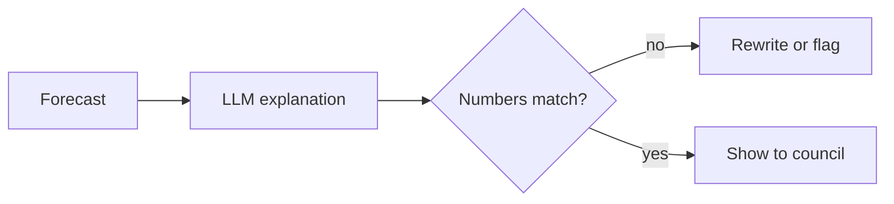

# Interview prep: Brightwater Analytics

Machine Learning Engineer. First interview with the engineering lead, 45 minutes.

> **TL;DR**
> - Lead with the evaluation suite and the 71% to 83% accuracy study.
> - Be straight about forecasting: not in production yet, studying it now.
> - Ask how they check the LLM explanations against the forecast numbers.

## Likely questions

| Question | Your best evidence | Watch for |
|---|---|---|
| How do you know a model is good enough to ship? | Nightly suite of 400 questions; 2-point release gate | Don't drift into tooling. Say what you measured. |
| Tell us about a model you improved. | Chunk size and reranking study, 71% to 83% | Explain the method in one sentence first. |
| How would you stop an LLM explanation from contradicting the forecast? | Answers checked against sources before release | Mention checks on numbers, not just text. |
| What's your forecasting experience? | Honest: studying it now | Name what you'd learn first. |

## Your 60-second pitch

I build LLM features and the tests that keep them honest. At Sampletown Software I lead the retrieval platform behind our support assistant. I built the nightly evaluation that blocks a bad release, and a study I ran lifted answer accuracy from 71% to 83%. Brightwater's plain-word explanations need the same habit: check every sentence against the numbers.

## Questions to ask them

1. How do councils use the forecasts today?
2. Who reviews the explanations before they go out?
3. What would a great first 90 days look like?

> **Tip:** Bring one diagram of the evaluation suite. Drawing it beats describing it.
