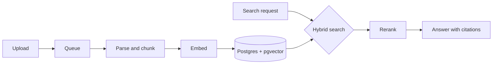

# Interview prep: Example Labs

Backend Engineer (LLM). Technical interview with two engineers, 60 minutes.

> **TL;DR**
> - They serve 40 million pages. Talk about ingestion queues and latency.
> - Have the 6.1 s to 2.4 s story ready, with what you measured.
> - Expect a system design question on hybrid search.

## Likely questions

1. Design ingestion for 40 million legal pages. Where does it break first?
2. How would you combine keyword and vector search?
3. A search request is slow. Walk us through finding why.
4. What would you put on the on-call dashboard?

## System design sketch

> **Watch out:** Don't skip cost. Embedding 40 million pages is a budget question as well as a design one.
