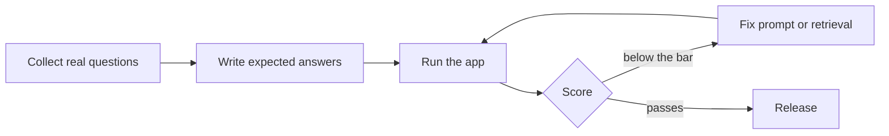

# Evaluating LLM apps

A study guide for Alex Example. Three of your saved jobs ask for evaluation experience.

> **TL;DR**
> - Build a fixed test set before you change anything.
> - Score answers for correctness, grounding and format.
> - Gate releases on the score, and spot-check by hand.

## Why employers ask

Most LLM features look fine in a demo. Evaluation is how a team knows a change made things better, not just different.

> **Interview tip:** Name the metric, the test set size and one regression you caught.

## The loop



## What to measure

| Metric | What it checks | How to score it |
|---|---|---|
| Correctness | Is the answer right? | Compare with the expected answer |
| Grounding | Is every claim in the sources? | Check citations against the text |
| Format | Does it follow the rules? | Simple code checks |
| Latency | Is it fast enough? | Time each call |
| Cost | Is it affordable? | Tokens per answer |

> **Watch out:** An LLM judge can be wrong too. Spot-check a sample of its scores by hand every week.

## Worked example

A release gate in a few lines:

```python
score = run_suite(questions)          # 0 to 100
if score < last_release_score - 2:
    raise SystemExit("Grounded answers dropped. Release blocked.")
```

## Practice this week

1. Write 20 questions from one product's docs.
2. Score your app on them, by hand first.
3. Automate one check and compare it with your hand scores.

## Key terms

- **Test set:** fixed questions with expected answers.
- **Grounding:** every claim can be found in the sources.
- **Regression:** a change that makes scores worse.
