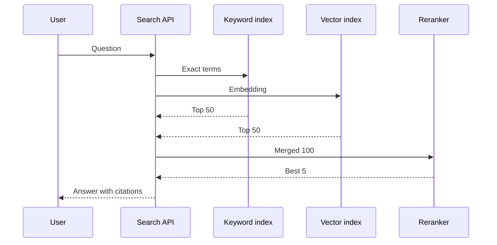

# Vector search and hybrid retrieval

A study guide for Alex Example. Example Labs asks about hybrid search.

> **TL;DR**
> - Vectors find meaning. Keywords find exact terms.
> - Hybrid search runs both and merges the results.
> - A reranker puts the best few at the top.

## How a query flows

## Keyword vs vector vs hybrid

| Approach | Finds | Misses | Good for |
|---|---|---|---|
| Keyword | Exact names, case numbers | Synonyms | Legal citations, IDs |
| Vector | Meaning, paraphrases | Rare exact terms | Natural questions |
| Hybrid | Both | Costs more | Most real apps |

> **Tip:** Legal search needs exact matches for case names. Say this in the Example Labs interview.

## Practice this week

1. Index 1,000 pages in Postgres with pgvector.
2. Add a keyword index on the same table.
3. Compare the top 5 results for 10 questions.
